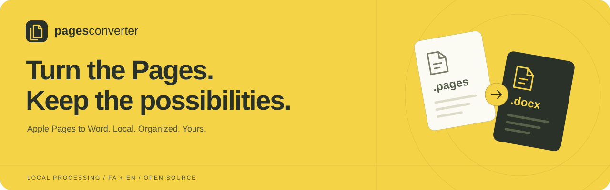
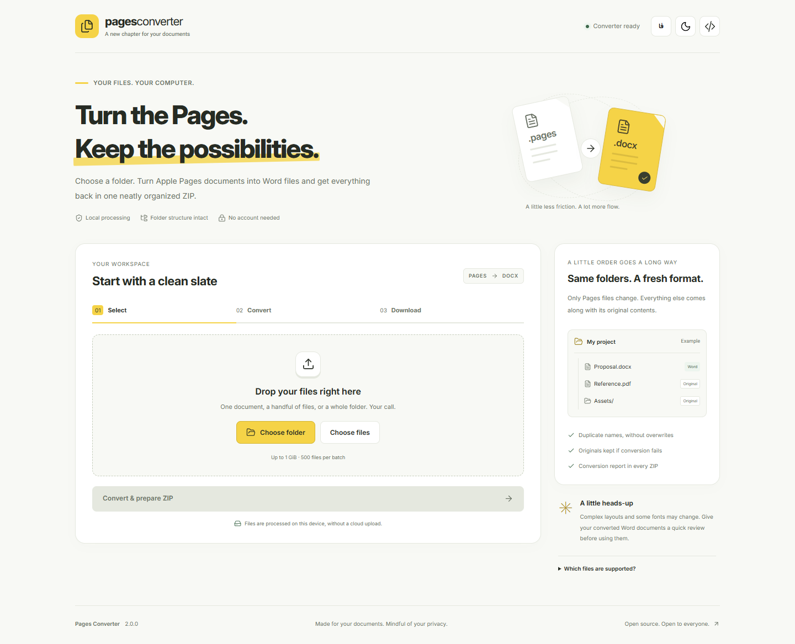

<div align="center">



**Apple Pages → Word. Your folders, still in order. Your files, still on your computer.**

[](https://github.com/maboox/pagestodoc/actions/workflows/ci.yml)
[](https://www.python.org/downloads/)
[](LICENSE)
[](SECURITY.md)

[](https://github.com/maboox/pagestodoc/archive/refs/heads/main.zip)
[](#quick-start)

**English** · **[فارسی — راهنمای کامل](docs/README.fa.md)** · [Changelog](CHANGELOG.md) · [Security](SECURITY.md)

</div>

## Meet your new document workspace

Choose files or a whole folder, convert supported `.pages` documents into `.docx`, and download one ZIP. Nested folders stay organized; other files keep their original bytes. No account, cloud conversion service, analytics, or runtime CDN.



| A smoother workflow | A safer foundation |
| --- | --- |
| Persian RTL and English interfaces | Loopback-only server with Host and Origin checks |
| Light and dark themes; local Inter and Vazirmatn fonts | Session cookies and CSRF tokens |
| File/folder selection and recursive folder drops in Chromium | Bounded disk-backed upload parsing and streamed downloads |
| Live progress, cancellation, and repeat downloads | Case-insensitive names allocated without overwrites |
| Reload recovery during the same app session | Failed conversions retain the original Pages document |
| Keyboard access and responsive layouts | Every ZIP includes an input → output report |

## Quick start

### Windows

1. Install **[Python 3.10 or newer](https://www.python.org/downloads/windows/)** and enable **Add Python to PATH**.
2. Install a current, supported **[LibreOffice](https://www.libreoffice.org/download/download-libreoffice/)** release.
3. [Download the source ZIP](https://github.com/maboox/pagestodoc/archive/refs/heads/main.zip) and **extract it**, or clone:

   ```sh
   git clone https://github.com/maboox/pagestodoc.git
   cd pagestodoc
   ```

4. Double-click **`start.bat`**. On the first launch it creates `.venv` and installs the pinned Python packages from PyPI. This setup step needs internet access; normal app use does not require a cloud service.
5. Your browser opens at **`http://127.0.0.1:8765`**. Select files or a folder, prepare the ZIP, then choose **Save ZIP** (Chrome/Edge) or **Download ZIP**.

The terminal must stay open while processing or downloading. Press **Ctrl+C** to stop. This release is Python source, not a standalone Windows installer; LibreOffice is installed separately.

### macOS / Linux

Install Python 3.10+ and LibreOffice, then run `sh start.sh`. Linux installations may need their distribution's `python3-venv` package. macOS LibreOffice is detected in `/Applications`. Windows is the primary user platform; automated pipeline tests also cover Linux and macOS.

### Manual setup and another port

```sh
python -m venv .venv
# Windows:
.venv\Scripts\python -m pip install -r requirements.txt
.venv\Scripts\python app.py --open --port 9000
# macOS / Linux:
.venv/bin/python -m pip install -r requirements.txt
.venv/bin/python app.py --open --port 9000
```

Use `127.0.0.1`, rather than `localhost`: the exact Host check is intentional. `PORT` sets the default port. `PAGES_SOFFICE` may point to an installed LibreOffice executable outside the usual location. The app never downloads or bundles LibreOffice.

## What happens to each file?

```text
Input                            Downloaded ZIP
Project/                         Project/
├── Proposal.pages               ├── Proposal-2.docx   ← converted
├── Proposal.docx                ├── Proposal.docx     ← original bytes
└── References/                  └── References/
    ├── Brief.pdf                    ├── Brief.pdf     ← original bytes
    └── Unsupported.pages            └── Unsupported.pages ← kept if conversion fails
                                 pages-converter-report.json
```

Existing Word files take priority over generated names. Collisions, including names differing only by case, get `-2`, `-3`, etc. The JSON report records the requested name, final ZIP path, outcome, and a stable error code. If an input already uses the report's name, the generated report gets a numbered name too.

| Input / event | Result |
| --- | --- |
| Supported single-file `.pages` archive | Converted to `.docx` by LibreOffice |
| Other file types | Copied byte for byte, without conversion |
| Unsupported, damaged, encrypted, or oversized Pages archive | Original retained; failure code in the report |
| Unsafe path or Windows-reserved filename | Batch rejected with an explanation; rename it and try again |
| Cancel processing | Worker stops and deletes that job's temporary data |
| Download again | Available for one hour in the same running app |
| Delete local output | Removes the app's retained ZIP; already downloaded copies remain yours |

## Privacy, without vague promises

The app sends documents to its **local loopback server**, not a conversion website. Fonts, icons, scripts, and styles ship in the repository. User preferences are stored locally; session storage keeps only a job ID for reload recovery. The browser stores a short-lived local session cookie.

Uploads, working files, and results use temporary local disk space. Successful jobs discard their working copies and retain the ZIP for up to one hour. The cleanup sweep runs every minute while the app is running; a normal shutdown removes retained jobs. A forced shutdown or crash can leave temporary files behind. Downloads saved by your browser are not automatically deleted. See the [security model and recovery notes](SECURITY.md).

LibreOffice is a separate native program and is **not an operating-system sandbox**. Use current versions and documents you trust. The app uses an isolated profile with the highest macro security, but cannot guarantee that every document or third-party engine is vulnerability-free.

## Practical limits

- **1 GiB total file contents**, at most **500 files**, one active batch per app instance.
- At most three retained results; remove old outputs before starting more batches.
- Five-minute timeout per Pages conversion; ZIP packing has its own progress stage.
- Conversion may change fonts, tables, charts, media, and complex page layouts. Inspect the result before sharing it.
- Single-file Pages archives are supported. Save macOS Pages package directories as single files first.
- Empty folders cannot be preserved by browser uploads. Chrome or Edge is recommended for folder selection and directory drops.
- Paths are normalized to NFC and must be portable to Windows: at most 220 characters overall and 120 per component. Unsafe names are rejected rather than silently stripped.
- Keep enough free temporary disk space for uploads, generated documents, and the ZIP. Files may expand during conversion.

## Troubleshooting

| Symptom | What to do |
| --- | --- |
| Python missing / Store alias opens | Install Python with PATH enabled; the launcher also supports `py -3` |
| Setup cannot download packages | Check PyPI access; see [offline setup](docs/TESTING.md#offline-installation) |
| LibreOffice not found | Install it, use **Check again**, or set `PAGES_SOFFICE` |
| A file was not converted | Open the JSON report; update LibreOffice or export from Apple Pages on macOS |
| Session changed | Reload the page after restarting the app |
| Port already in use | Close the other instance or use `--port 9000` |
| Output expired | Reselect your files and process them again |
| Browser blocks the attachment download | Use **Save ZIP** to choose a destination and stream directly to disk in Chrome/Edge |

## Development

Runtime: Python, Werkzeug, Waitress, MarkupSafe, and your installed LibreOffice. Frontend: plain JavaScript and local Lucide SVG icons. Node is needed only for development checks.

```sh
python -m pip install -r requirements.txt -r requirements-dev.txt
python -m unittest discover -s tests -v
python -m ruff check .
npm ci
npx playwright install chromium
npm run check
npm run test:ui
```

See [architecture](docs/ARCHITECTURE.md), [testing](docs/TESTING.md), [contributing](CONTRIBUTING.md), and the [release checklist](docs/RELEASING.md). CI covers portable file handling, HTTP security, cancellation, real LibreOffice conversions, UI flows, and automated accessibility checks.

## فارسی

**تبدیل دسته‌ای Pages به Word، با حفظ نظم پوشه‌ها و پردازش روی کامپیوتر خودتان.** رابط فارسی و انگلیسی، تم زرد روشن و تیره، امکان لغو و دانلود مجدد، و نگهداری اصل فایل در صورت شکست تبدیل دارد. برای شروع Python و LibreOffice را نصب و `start.bat` را اجرا کنید. [راهنمای کامل فارسی ←](docs/README.fa.md)

## License and acknowledgements

Application code is [MIT licensed](LICENSE). [Lucide](https://lucide.dev/), [Inter](https://rsms.me/inter/), and [Vazirmatn](https://github.com/rastikerdar/vazirmatn) provide the local icons and fonts. Their licenses are retained; see [third-party notices](THIRD_PARTY_NOTICES.md). Apple Pages, Microsoft Word, and LibreOffice names belong to their respective owners; this independent project is not affiliated with them.
