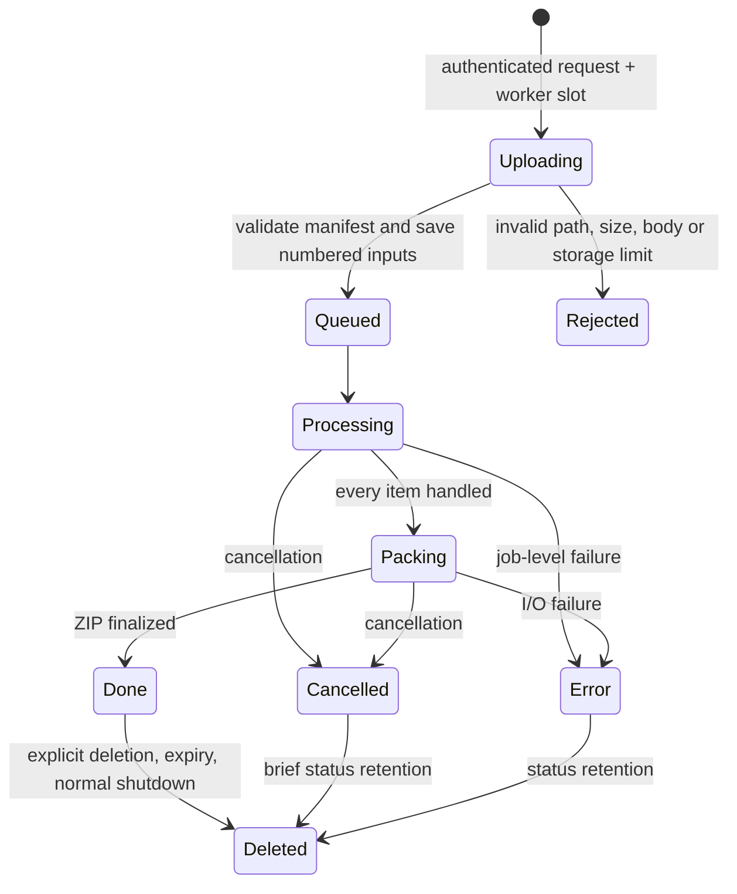

# Architecture

## Layers

| Module | Responsibility |
| --- | --- |
| `app.py` | Small executable entry point |
| `bootstrap.py` | Optional first-run `.venv` creation and pinned dependency installation |
| `pages_converter/server.py` | Loopback WSGI routing, authorization, multipart limits, security headers, streaming responses |
| `pages_converter/paths.py` | Portable path validation and case-insensitive file/directory name allocation |
| `pages_converter/jobs.py` | Single-worker gate, lifecycle, progress, ZIP/report creation, cancellation, download leases, cleanup |
| `pages_converter/conversion.py` | Archive checks, engine discovery, isolated profile, native process lifetime, DOCX validation |
| `index.html`, `assets/` | Local bilingual interface, styles, icons, and fonts |

Werkzeug provides maintained HTTP/form primitives; Waitress provides a bounded Windows-compatible WSGI server. The UI has no framework or build step. Only the icon subset and font files are vendored; library notices stay with them. Node dependencies are development-only.

## Job lifecycle

Conversion errors affect one document: its original is copied and an error code goes into the report. Unexpected job-level errors stop the batch and return a generic code; engine output and tracebacks are never serialized. The user still has their original files outside the app.

## Naming and storage

First reserve every input name, including file/directory relationships, using NFC-normalized casefold keys. Then reserve generated Word paths and the report path. This makes existing pass-through documents and possible failure originals take priority over generated output. Duplicate originals and generated paths receive numbered suffixes. Input and output files are numbered on local disk; logical folder paths are used only as ZIP names. This avoids host filesystem path-length and device-name surprises.

Multipart data is disk-backed and closed on every parser exit. The manager admits one active batch and caps retained jobs. Conversion, copying, and packing are performed in one worker. ZIP writes use fixed-size chunks and check cancellation. Download streams hold a reader lease; deletion and expiry wait until readers close. A monotonic deadline controls retention, independent of system clock adjustments.

## HTTP API

Open `/` to establish the session cookie and CSRF token; the UI does this automatically. These are local implementation endpoints, not a public cloud API.

| Method | Path | Purpose |
| --- | --- | --- |
| GET | `/api/health` | Engine availability, app version, limits |
| POST | `/api/jobs` | Multipart `manifest` JSON array plus repeated `files` fields |
| GET | `/api/jobs/{id}` | Redacted public status and counters |
| DELETE | `/api/jobs/{id}` | Request cancellation or delete completed data |
| GET | `/api/jobs/{id}/download` | Stream completed ZIP |
| GET | `/api/jobs/{id}/content` | Authenticated byte stream for the native save picker |

All API calls require the session cookie. Mutations also require `X-Pages-Token`. Paths, request origins, content length, part count, and form memory are checked independently. Static assets have an explicit allowlist; the repository, source files, and arbitrary paths are never served.

## Deliberate boundaries

No database, account system, cloud API, telemetry, or automatic background service. No claim of pixel-perfect Pages fidelity. No operating-system sandbox around LibreOffice. Cleanup after crashes and browser-downloaded files remains outside normal in-process retention; see [SECURITY.md](../SECURITY.md).
