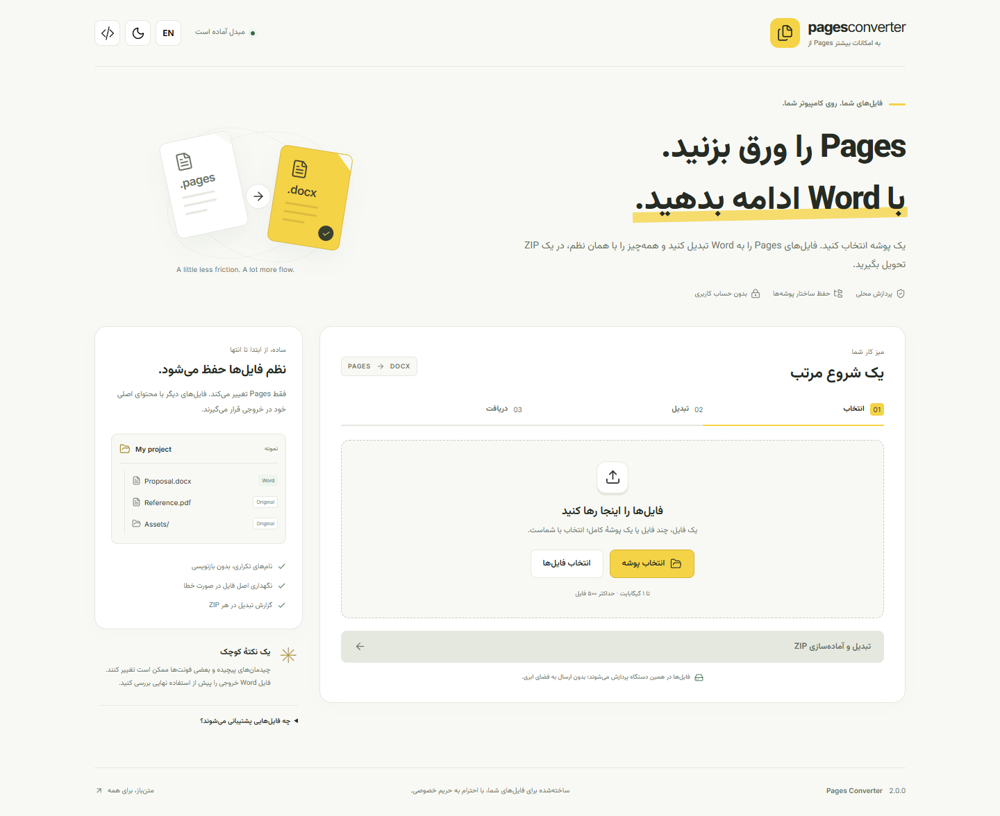

# Pages Converter — یک شروع مرتب برای فایل‌ها

**تبدیل دسته‌ای Pages به Word، روی کامپیوتر خودتان، با تم زرد و رابط فارسی.**

[English](../README.md) · [دریافت سورس](https://github.com/maboox/pagestodoc/archive/refs/heads/main.zip) · [تغییرات](../CHANGELOG.md) · [امنیت](../SECURITY.md)

## چه کاری انجام می‌دهد؟

یک فایل، چند فایل یا پوشه‌ای با زیرپوشه‌ها را انتخاب کنید. برنامه فایل‌های تکیِ `.pages` پشتیبانی‌شده را با LibreOffice به `.docx` تبدیل می‌کند و فایل‌های دیگر را با همان محتوای اصلی در ZIP قرار می‌دهد. ساختار پوشه‌ها حفظ می‌شود. اگر تبدیل یک فایل ممکن نباشد، اصل Pages در خروجی نگهداری می‌شود و علت در گزارش نوشته می‌شود.

- رابط فارسی راست‌به‌چپ و انگلیسی؛ پوستهٔ روشن و تیره.
- فونت‌های محلی وزیرمتن و Inter و آیکون‌های Lucide؛ بدون نیاز به CDN هنگام استفاده.
- انتخاب پوشه، رها کردن پوشه و خواندن زیرپوشه‌ها در مرورگرهای Chromium.
- پیشرفت زنده، لغو پردازش، دانلود مجدد و بازیابی وضعیت پس از بارگذاری دوبارهٔ صفحه.
- جلوگیری از بازنویسی فایل‌های همنام؛ فایل Word موجود شما حفظ می‌شود.
- گزارش `pages-converter-report.json` در هر ZIP، شامل نام ورودی، مسیر خروجی، نتیجه و کد خطا.

## نصب و اجرا در ویندوز

۱. [Python 3.10 یا جدیدتر](https://www.python.org/downloads/windows/) را نصب کنید و گزینهٔ **Add Python to PATH** را فعال کنید.

۲. نسخهٔ پشتیبانی‌شده و به‌روز [LibreOffice](https://www.libreoffice.org/download/download-libreoffice/) را نصب کنید.

۳. [ZIP سورس](https://github.com/maboox/pagestodoc/archive/refs/heads/main.zip) را دریافت و **از حالت فشرده خارج کنید**؛ یا ریپو را کلون کنید.

۴. روی **`start.bat`** دوبار کلیک کنید. اجرای اول محیط `.venv` می‌سازد و بسته‌های پایتون با نسخهٔ مشخص را از PyPI نصب می‌کند؛ این مرحله اینترنت می‌خواهد. LibreOffice جداگانه نصب می‌شود.

۵. مرورگر روی **`http://127.0.0.1:8765`** باز می‌شود. فایل یا پوشه را انتخاب کنید، «تبدیل و آماده‌سازی ZIP» را بزنید و سپس **«ذخیره ZIP»** را برای انتخاب محل ذخیره در Chrome/Edge یا **«دریافت ZIP»** را انتخاب کنید. ذخیرهٔ مستقیم به‌صورت تدریجی است و کل ZIP را در حافظه بارگذاری نمی‌کند.

پنجرهٔ برنامه را تا پایان کار باز نگه دارید. برای توقف، **Ctrl+C** بزنید. این انتشار سورس پایتون است و نصب‌کنندهٔ مستقل ویندوز ندارد.

در لینوکس و macOS، پس از نصب Python و LibreOffice دستور `sh start.sh` را اجرا کنید. در لینوکس ممکن است بستهٔ `python3-venv` لازم باشد. برای پورت دیگر، از `start.bat --port 9000` استفاده کنید؛ مرورگر همان پورت را باز می‌کند. مسیر استاندارد برنامه `127.0.0.1` است، نه `localhost`.

## نام فایل‌ها و نتیجهٔ تبدیل

اگر `Report.pages` و `Report.docx` را با هم انتخاب کنید، فایل Word موجود دست‌نخورده می‌ماند و نتیجهٔ تبدیل با نامی مانند `Report-2.docx` ذخیره می‌شود. تفاوت حروف کوچک و بزرگ نیز برای جلوگیری از برخورد نام‌ها در نظر گرفته می‌شود. مسیر نهایی هر فایل در گزارش مشخص است.

نام‌های ناسازگار با ویندوز، مانند `CON` و `AUX`، مسیرهای دارای `..`، نویسه‌های غیرمجاز و مسیرهای خیلی طولانی رد می‌شوند. ابتدا نام را اصلاح کنید و دوباره تلاش کنید. مسیر حداکثر ۲۲۰ نویسه و هر بخش حداکثر ۱۲۰ نویسه است.

## حریم خصوصی و محدودیت‌های امنیتی

برنامه فایل‌ها را به سرور **محلی روی همین دستگاه** می‌فرستد؛ سرویس تبدیل ابری، حساب کاربری یا آمارگیری ندارد. مرورگر ترجیح زبان و پوسته، یک کوکی نشست محلی و شناسهٔ پردازش را برای بازیابی وضعیت نگه می‌دارد. نام یا محتوای فایل‌ها در تنظیمات مرورگر ذخیره نمی‌شوند.

فایل‌ها هنگام پردازش در پوشهٔ موقت سیستم قرار دارند. پس از موفقیت، نسخه‌های کاری حذف می‌شوند و ZIP حداکثر یک ساعت نگه داشته می‌شود. پاک‌سازی هر دقیقه و هنگام خروج عادی انجام می‌شود. «حذف خروجی محلی» ZIP نگهداری‌شده توسط برنامه را حذف می‌کند؛ نسخه‌ای که خودتان دانلود کرده‌اید حذف نمی‌شود. قطع برق، توقف اجباری یا کرش می‌تواند فایل موقت باقی بگذارد؛ راهنمای [امنیت](../SECURITY.md) این مورد را توضیح می‌دهد.

LibreOffice برنامه‌ای جداگانه است و در یک سندباکس سیستم‌عامل اجرا نمی‌شود. پروفایل مجزا و بالاترین سطح امنیت ماکرو استفاده می‌شود، اما تضمین بی‌نقص بودن همهٔ اسناد یا موتور تبدیل ممکن نیست. از نسخهٔ به‌روز و فایل‌های مورد اعتماد استفاده کنید.

## محدودیت‌ها

- سقف هر نوبت **۱ گیبی‌بایت** محتوا و **۵۰۰ فایل**؛ یک پردازش فعال در هر اجرای برنامه.
- حداکثر سه خروجی نگهداری می‌شود. برای نوبت‌های بیشتر، خروجی قبلی را حذف کنید.
- مهلت تبدیل هر فایل Pages پنج دقیقه است.
- چیدمان پیچیده، جدول، نمودار، رسانه و فونت‌ها ممکن است تغییر کنند؛ خروجی Word را بررسی کنید.
- بسته‌های پوشه‌ای Pages را ابتدا در macOS به فایل تکی ذخیره کنید. پوشه‌های خالی با انتخاب مرورگر منتقل نمی‌شوند.
- Chrome یا Edge برای انتخاب و رها کردن پوشه پیشنهاد می‌شود.
- فضای خالی کافی برای ورودی، فایل‌های تبدیل‌شده و ZIP در دیسک موقت لازم است.

## رفع مشکل

| مشکل | راه‌حل |
| --- | --- |
| Python پیدا نمی‌شود | نصب با PATH فعال؛ لانچر از `py -3` هم پشتیبانی می‌کند |
| نصب بسته‌ها شکست خورد | دسترسی PyPI و امکان ساخت محیط مجازی را بررسی کنید؛ [نصب آفلاین](TESTING.md#offline-installation) |
| LibreOffice پیدا نشد | نصب کنید و «بررسی دوباره» را بزنید؛ برای مسیر سفارشی `PAGES_SOFFICE` را تنظیم کنید |
| فایلی تبدیل نشد | کد خطا در گزارش را ببینید، LibreOffice را به‌روز کنید یا از Apple Pages خروجی بگیرید |
| نشست تغییر کرده | پس از راه‌اندازی دوبارهٔ برنامه، صفحه را بارگذاری مجدد کنید |
| پورت اشغال است | اجرای دیگر را ببندید یا `--port 9000` بدهید |
| مرورگر دریافت ZIP را مسدود کرده | در Chrome/Edge گزینهٔ «ذخیره ZIP» را بزنید و محل ذخیره را انتخاب کنید |

## توسعه و مشارکت

کد برنامه با مجوز [MIT](../LICENSE) منتشر شده است. راهنمای [مشارکت](../CONTRIBUTING.md)، [معماری](ARCHITECTURE.md) و [تست](TESTING.md) برای توسعه‌دهندگان در دسترس است. نمونه‌های آزمایش و تصاویر مستندات شامل فایل شخصی کاربران نیستند.

